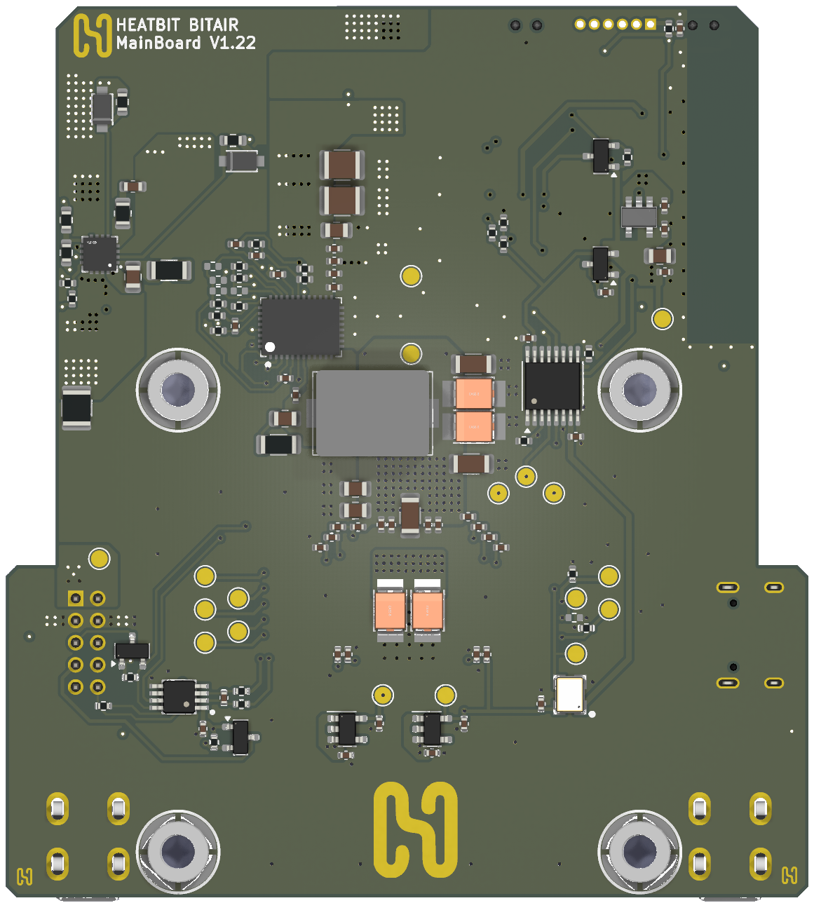
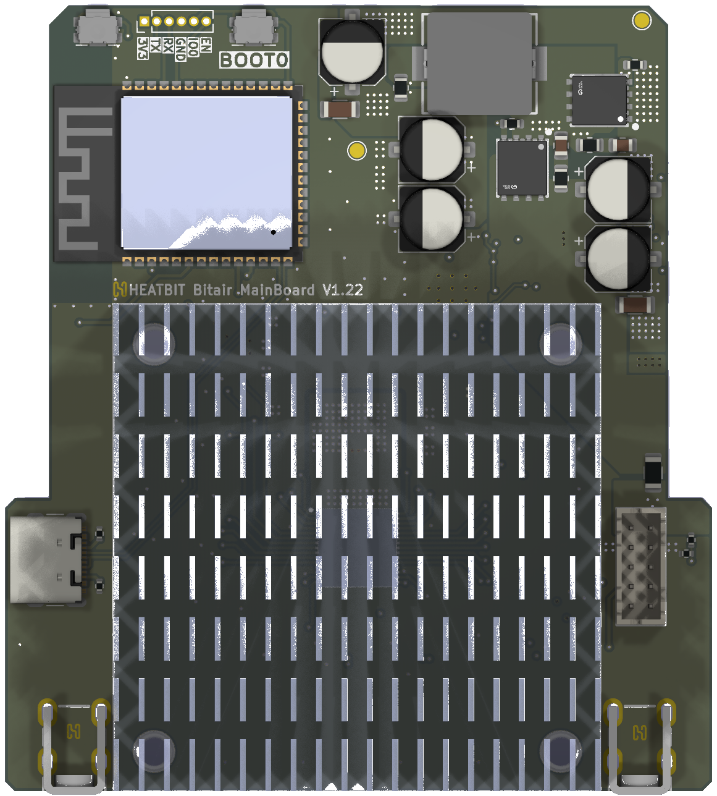

# Heatbit Bitair Mainboard

The mining mainboard of the Heatbit Bitair air purifier. It carries a single
Bitmain **BM1370** Bitcoin mining ASIC and an **ESP32-S3**, and the heat from
the ASIC is used by the purifier.

The design is based on the open source
[bitaxeGamma](https://github.com/bitaxeorg/bitaxeGamma) by bitaxeorg. See [NOTICE.md](NOTICE.md) for the upstream revision
and the full list of changes.

## Status

| Revision | Date       | Status                         |
|----------|------------|--------------------------------|
| V1.22    | 2026-08-24 | Production, shipped in Bitair  |
| V1.11    | 2026-07-31 | Internal, debugging only       |
| V1.00    | 2026-07-10 | Internal, debugging only       |

See [CHANGELOG.md](CHANGELOG.md).

## Overview

- ASIC: Bitmain BM1370 (the chip used in the Antminer S21 Pro). It is not
  open source and is not sold individually. Upstream reports about
  1.2 TH/s per chip.
- Core power: TI TPS546D24A step-down converter for the ASIC core (VDD),
  same as bitaxeGamma.
- 5 V rail: an on-board step-down converter from the CN1 input (sheet
  `Power_15_5`, NDP1415QF controller).
- MCU: ESP32-S3-WROOM-1 (N16R8).
- Fan control and ASIC temperature: Microchip EMC2101.
- PCB: 4 layers, about 72.5 × 80.5 mm. KiCad 10 (the files no longer open in KiCad 9).

**Active cooling is mandatory.** The board is designed to run with the
purifier's heatsink and airflow. Running it without them will overheat the
ASIC.

## Connectors

### CN1: system connector (JST B10B-PHDSS, 2 mm, 10 pins)

This connector links the board to the rest of the air purifier.

| Pin | Net       | Description |
|-----|-----------|-------------|
| 1   | VBUS      | Power input. 15 V nominal; the input converter enables at about 12 V (see the notes on sheet `Power_15_5`). Protected by fuse F1 (3 A). |
| 2   | VBUS      | Power input, same as pin 1 |
| 3   | GND       | Ground |
| 4   | GND       | Ground |
| 5   | SCL (ext) | I2C clock for an external sensor (AHT20). Level-shifted by Q4 (2N7002) from the 3.3 V bus. Needs a pull-up on the external side. |
| 6   | LED       | ESP32 GPIO41, 3.3 V logic, direct |
| 7   | SDA (ext) | I2C data for an external sensor. Level-shifted by Q5 (2N7002). Needs a pull-up on the external side. |
| 8   | FAN       | ESP32 GPIO40 through the level shifter Q3 (2N7002, 5.1 kΩ pull-up to 3.3 V on the ESP32 side). Pulled low when GPIO40 is low; needs a pull-up on the external side. |
| 9   | B         | ESP32 GPIO39, 3.3 V logic, direct |
| 10  | FAN_PWM   | Fan PWM from the EMC2101, 10 kΩ pull-up to 5 V |

The ESP32 measures the VBUS voltage on GPIO6 through a 51 kΩ / 12 kΩ divider.

### J5: USB-C

USB 2.0 data to the ESP32-S3, used for flashing and logs. USB VBUS is **not
connected**: the board cannot be powered from USB.

### J1: programming header (not populated)

A 1.27 mm, 6-pin footprint: 3V3, TX, RX, GND, IO0, EN (ESP32 UART0 and boot).

## Repository contents

| Path | Contents |
|------|----------|
| `bitair-mainboard.kicad_pro` | KiCad 10 project |
| `*.kicad_sch` | Schematic: root sheet, `bm1370`, `power`, `Power_15_5`, `esp32`, `fan` |
| `bitair-mainboard.kicad_pcb` | PCB |
| `bitaxe.kicad_sym`, `bitaxe.pretty` | Symbol and footprint libraries from upstream bitaxe |
| `bitair.kicad_sym`, `bitair.pretty`, `Heatbit.kicad_sym`, `Heatbit.pretty` | Libraries added by Heatbit |
| `3d`, `3dshapes` | 3D models used by the PCB, see [THIRD_PARTY.md](THIRD_PARTY.md) |
| `OUTPUTS/` | Fabrication outputs for V1.22: Gerbers and drill files, BOM, pick-and-place, schematic PDF |

## Manufacturing

- Gerbers and drill files: `OUTPUTS/HB Bitair MainBoard V1.22 GBR/`
- BOM: `OUTPUTS/Assembly/BOM/` (xlsx and csv). The `LCSC` column lists the
  parts used in production. `Manufacturer`/`MPN` are filled where known.
  `Alt MPN`/`DigiKey` are the alternatives inherited from bitaxeGamma for
  parts that did not change.
- Pick-and-place: `OUTPUTS/Assembly/PnP/`
- Schematic PDF: `OUTPUTS/Assembly/Circuit Diagram/`

The BM1370 is not available from regular distributors.

See [building.md](building.md) for generating fabrication files and
[assembly.md](assembly.md) for hand-assembly tips from the bitaxe project.

## Firmware

The firmware is not part of this repository.

## Licence

Copyright (c) 2026 Heatbit Inc. Based on bitaxeGamma, copyright (c)
bitaxeorg.

This design is licensed under the
[CERN-OHL-S-2.0](LICENSE). If you distribute boards or modified designs based
on it, you must make your complete modified source available under the same
licence.

"Heatbit", "Bitair" and the Heatbit logo are trademarks of Heatbit Inc. and
are not covered by the licence. See [TRADEMARKS.md](TRADEMARKS.md) before
manufacturing boards from this design. Bitaxe is a trademark of bitaxeorg;
this is not an official Bitaxe product.

Third-party components and 3D models are listed in
[THIRD_PARTY.md](THIRD_PARTY.md).
